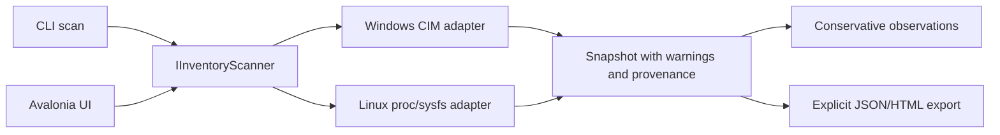

# Architecture and capability boundary

The original inventory boundary below remains historical context. Separate consented WUA/Ubuntu discovery and downloads are described in [driver discovery](driver-discovery.md); statements below about catalogs being absent apply to offline scan only. CLI remains offline. No installation/rollback was added.

The MVP answers what the OS exposes, not which update should be installed. UI and CLI use IInventoryScanner and the same Snapshot/Device contracts. Device ProblemCode is nullable; null is unknown, not success. Hardware identifiers are observations, not a matched package. Windows CIM data is collected as JSON, not parsed localized console tables. Linux reads known read-only attributes, never config/resource/rom/control files.

Windows: separate fixed PowerShell process, no profile, no shell execution, no caller-supplied command, no persistent execution-policy change or administrator request. Child lifetime is bounded, outputs are bounded and failures/cancellation terminate the child. Private instance IDs are hashed inside the adapter before JSON; serial fields, hostname, user, MAC and personal files are not requested. Name and HardwareID can still contain identifying labels; review exports.

Linux: /proc/cpuinfo/meminfo/kernel, /etc/os-release, selected DMI strings and PCI/USB attributes. Human names may be missing; hex IDs remain useful. USB interface and parent records can both appear and are not unique product counts. SoC/platform/I2C/SPI/virtual devices and detailed audio endpoint routing are outside the initial bus scope. An alternate root exists for tests; its architecture is not asserted as the fixture's architecture.

Audio: only devices classified from the inventory. No stream, microphone, playback, routing or service mutation. WMI signature metadata is not Authenticode verification. No catalog client means update availability is UNKNOWN. No background history/SQLite or operation telemetry; result warnings and UI/CLI summaries are the initial local diagnostic record.

Future matching must require exact IDs, subsystem/OEM, OS+architecture/kernel applicability, official candidate provenance/signatures/dependencies and manufacturer compatibility. A separate administrative component, individual approval and VM rollback evidence are required before any safe-install feature. Do not expose unimplemented install buttons or fabricated candidates.
